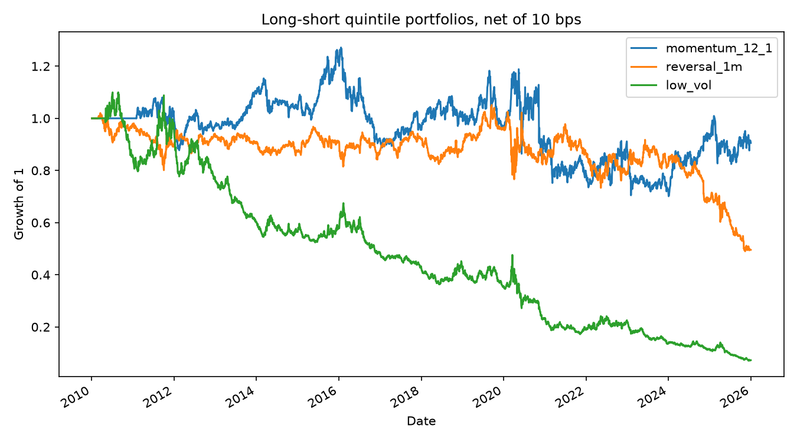
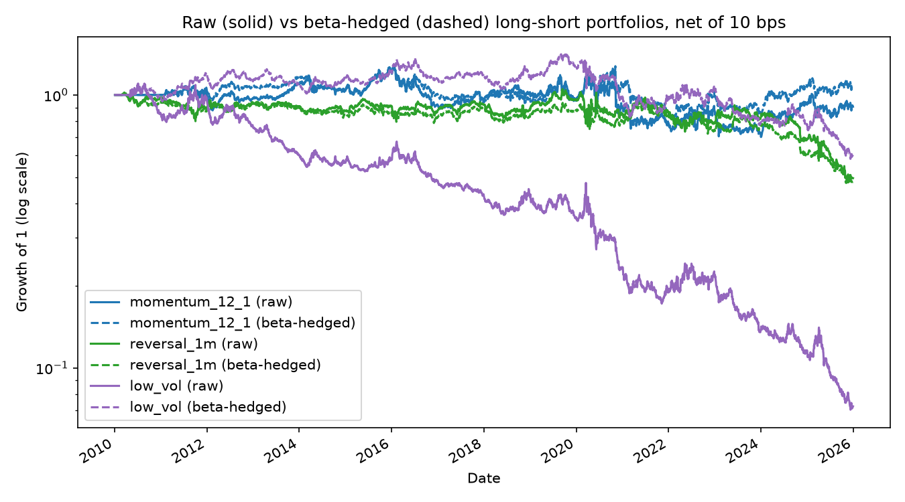

# Do classic equity factors still work in the S&P 500?

**Short answer: not in this setup.** On S&P 500 stocks from 2010 to 2025, long-short quintile portfolios built on 12-1 momentum, 1-month reversal and low volatility all failed to earn a positive return after 10 bps trading costs. Low volatility lost 94% at its worst, but about 90% of that loss is explained by its negative market beta: once the beta is hedged out, what remains is small and not statistically significant.



## Results (2010–2025, net of 10 bps per unit of turnover)

| Factor | Ann. return | Ann. vol | Sharpe | Max drawdown | Mean rank IC (21d) | IC t-stat | Turnover / rebalance |
|---|---|---|---|---|---|---|---|
| 12-1 momentum | -0.6% | 16.7% | 0.05 | -44.9% | 0.009 | 0.62 | 0.89 |
| 1-month reversal | -4.3% | 13.8% | -0.25 | -53.4% | 0.012 | 1.07 | 3.09 |
| Low volatility (63d) | -15.2% | 19.9% | -0.73 | -93.6% | -0.028 | -1.60 | 0.77 |

## What the numbers say

- **Momentum** has a slightly positive IC but no statistically significant edge (t = 0.62). It rose to about +27% by early 2016, then gave it back in the 2016 and 2020–2021 momentum reversals.
- **Reversal** has the highest IC of the three, but there is almost no edge even before costs (gross Sharpe 0.02). It trades the most, replacing about three quarters of the book each month (turnover 3.09 out of a maximum of 4), so costs of about 3.7% a year turn it clearly negative. It drifted down about 18% by the end of 2023, then fell sharply in 2024–2025.
- **Low volatility** lost steadily for 15 years. A dollar-neutral low-vol portfolio is long low-beta stocks and short high-beta stocks, so it is effectively **short market beta** during one of the longest bull markets on record. The beta attribution below confirms that this explains most of the loss.

## Is it just market beta?

`run_attribution.py` answers this in two ways. First, it regresses each portfolio's daily net return on the market, with Newey-West t-stats. Second, it hedges the market out ex ante: on each rebalance day it estimates every stock's 252-day beta (using past data only), computes the portfolio beta, and shorts that much market until the next rebalance. The market proxy is the equal-weight return of the same 500 stocks, 18.3% a year.

| Factor | Beta | Alpha (ann.) | Alpha t-stat | R² | Avg ex-ante beta | Hedged ann. return | Hedged Sharpe |
|---|---|---|---|---|---|---|---|
| 12-1 momentum | -0.12 | 3.1% | 0.79 | 0.02 | 0.02 | 0.5% | 0.11 |
| 1-month reversal | 0.21 | -7.4% | -2.28 | 0.08 | -0.03 | -4.5% | -0.33 |
| Low volatility (63d) | -0.70 | -1.5% | -0.41 | 0.41 | -0.70 | -3.1% | -0.13 |



- **Low volatility:** the portfolio's beta is -0.70, both ex ante and ex post, and the market explains 41% of its daily variance. Beta times the market return accounts for -12.9% of its -14.5% arithmetic return a year, about 90%. The remaining alpha (-1.5%, t = -0.41) is not significant. Hedged, the strategy earned +2.5% a year in 2010–2019, then lost 11.8% a year from 2020 to 2025, so beta does not explain the recent weakness.
- **Momentum** has little market exposure, so hedging changes almost nothing.
- **Reversal** has a significantly negative alpha (t = -2.28), about half of which is trading costs. Its ex-ante beta is close to zero but its realised beta is 0.21, probably because the stocks it buys (last month's losers) become more sensitive to the market after it falls. A static hedge cannot remove that.

## Method

- **Universe:** current S&P 500 constituents (Wikipedia), daily adjusted close prices from yfinance, 2010–2025. Three tickers with no data were dropped.
- **Factors** (`src/factor_research/factors.py`): 12-month return skipping the last month; minus the last 21-day return; minus 63-day realised volatility.
- **Portfolio** (`src/factor_research/backtest.py`): rebalanced at each month end, equal-weight long the top quintile and short the bottom quintile, dollar-neutral.
- **Costs:** 10 bps per unit of turnover (`--cost-bps` to change).
- **Signal quality:** daily Spearman rank IC between the score and the next 21-day return. The t-stat is divided by √21 as a rough correction for overlapping windows.
- **No look-ahead:** weights decided at the close of day t earn the return from t to t+1. Unit tests check that changing future prices never changes past PnL or past betas.

## Limitations

- **Survivorship bias:** the universe is today's index members, so companies that were removed or went bankrupt are missing. This flatters long legs and hurts short legs.
- Flat cost model, no borrow fees on the short leg, no market-impact model.
- Portfolios are not neutralised for sector or size, and beta is hedged only as an overlay, without hedge costs.
- The market proxy is built from the same survivor-biased universe, so its 18.3% a year overstates the true market return and probably overstates how much of the low-vol loss is beta.

## Next steps

- [x] Beta-neutralise each portfolio and re-run, to separate factor alpha from market exposure.
- [ ] Regress returns on the Fama-French 5 factors plus momentum to measure alpha and its t-stat.
- [ ] Cost sensitivity from 0 to 30 bps, and a lower-turnover reversal (weekly signal, banded rebalancing).
- [ ] Combine the three z-scored factors into one composite signal.

## Run it

```bash
pip install -e ".[dev]"
pytest                               # 7 tests, including the look-ahead checks
python run_backtest.py --synthetic   # offline check on simulated prices (saves *_synthetic.png)
python run_backtest.py               # real S&P 500 data
python run_attribution.py            # beta regression and beta-hedged portfolios
```

## Structure

```
src/factor_research/   data.py · factors.py · backtest.py · metrics.py · attribution.py
tests/                 look-ahead, portfolio-construction and beta tests
reports/figures/       generated charts
```
